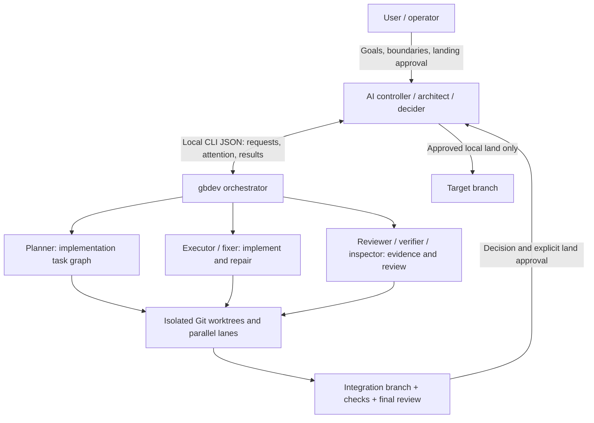

# gbdev

[](https://github.com/MarcusYuan/gbdev/actions/workflows/ci.yml)
[](LICENSE)

English | [简体中文](README.zh-CN.md)

**gbdev lets Grok Bot lead a team of local coding agents.** Grok Bot acts as architect and sole decider; **Codex CLI** and **Cursor agent** do the engineering work on your own machine — plan → implement → review → fix → merge — each in an isolated Git worktree.

## What is gbdev?

gbdev is a local command-line orchestrator. An AI controller (Grok Bot, or any controller that can run a local shell and read JSON) calls `gbdev … --json`; gbdev starts and supervises Codex and Cursor worker processes, collects evidence, and hands back structured status and decisions. It is not a hosted service: everything runs on your computer with your own provider logins. The runtime has no third-party production dependencies (Node.js built-ins only).

## What problem does it solve?

One AI can direct several coding agents, but doing that safely by hand is fragile: agents step on each other's files, review loops never end, "it passed" is unverified, and changes slip into `main` without anyone deciding. gbdev makes that supervision mechanical:

- **Isolated worktrees** — every worker gets its own Git worktree and branch; your checkout and target branch are untouched.
- **Parallel lanes** — a planner splits a goal into a task graph; independent tasks run in parallel lanes and merge into an integration branch.
- **Bounded review/fix loops** — reviewers and fixers iterate under explicit round, job, and time budgets; when the budget is used up, gbdev asks instead of looping.
- **Evidence, not vibes** — checks you trust run at every merge; worker output is untrusted data; a missing review verdict is never treated as approval; read-only `inspect` gathers bounded code evidence.
- **Explicit decisions** — plans, failures, and conflicts become `attention` items that the controller answers with the current decision ID and an allowed action.
- **No unreviewed merges, no pushes** — finished work waits on an integration branch. Updating your local branch needs `run land --confirm-user-approved`, which the controller may only run after you say yes. gbdev never pushes.



Codex CLI and Cursor agent are worker adapters; engineering roles (planner, executor, reviewer, fixer, resolver, verifier, inspector) are configurable. The controller stays outside the worker pool. See the [controller role guide](docs/controller-role.md).

## Set up in one instruction (Grok Bot)

Install and log into Codex CLI and/or Cursor agent on your computer first (`codex login`, `cursor-agent login`). Then paste this into Grok Bot:

```text
Set up gbdev for me by following https://github.com/MarcusYuan/gbdev/blob/main/docs/grokbot-setup.md
```

Grok Bot checks prerequisites, clones and builds gbdev, creates its own gbdev home and launcher, asks which repository to allow, verifies everything with `doctor`, installs the [gbdev-usage skill](skills/gbdev-usage/SKILL.md), and optionally connects webhook notifications. The only things you do yourself: provider logins, telling it which repository to use, and — if you want notifications — pasting the webhook secret into `notify setup` in your own terminal. The bot-facing guide is [docs/grokbot-setup.md](docs/grokbot-setup.md).

## How to use it

### Requirements

- **Node.js >= 24** and npm; **Git >= 2.38**; a Git repository with at least one commit.
- **Codex CLI** (`codex`) and/or **Cursor agent** (`cursor-agent`), installed and logged in by you. Provider access, models, and usage charges are your responsibility.
- Optional **tmux >= 3.2** for the live dashboard. macOS or Linux; native Windows is not supported.

### Manual setup

```sh
git clone https://github.com/MarcusYuan/gbdev.git
cd gbdev
npm ci --registry=https://registry.npmjs.org
npm run build
node dist/cli.js init --bot my-bot --json   # creates a home + launchers, prints result.command
```

`init` returns `result.command` (an absolute launcher such as `~/.gbdev-cli/bin/gbdev-my-bot`) and `result.config.path`. Use that launcher for every later command. To type plain `gbdev`, add the printed `path_hint` (`export PATH="$HOME/.gbdev-cli/bin:$PATH"`) to your own shell profile; gbdev never edits it. Below, `gbdev` stands for your launcher.

### Configuration

Add your repository's canonical absolute path (`cd repo && pwd -P`) to `allowed_repos` in the config file from `result.config.path`:

```json
{
  "version": 1,
  "allowed_repos": ["/absolute/path/to/repo"],
  "providers": {
    "codex": { "bin": "codex" },
    "cursor": { "bin": "cursor-agent", "model": "auto" }
  },
  "default_timeout_min": 30
}
```

`allowed_repos` is an exact-path allowlist, not a prefix grant; with no entry, gbdev refuses repository work. Without `init`, the default config is `~/.config/gbdev/config.json` (`GBDEV_CONFIG` overrides) and the default state home is `~/.gbdev` (`GBDEV_HOME` overrides). Then check the setup:

```sh
gbdev doctor --json       # node, git, config, roles, codex/cursor + login, tmux, ...
```

### A typical run

Describe the goal, boundaries, and trusted checks in a run request (`request.json`):

```json
{
  "schema": "gbdev.run-request.v1",
  "request_id": "add-health-endpoint",
  "repo": "/absolute/path/to/repo",
  "base_ref": "main",
  "goal": "Add a /health endpoint with tests",
  "context": "",
  "constraints": ["No new dependencies"],
  "allowed_paths": ["src/**", "test/**"],
  "checks": [{ "id": "test", "cmd": "npm test", "timeout_min": 10 }],
  "integration_checks": ["test"],
  "acceptance_criteria": [{ "id": "AC1", "text": "/health returns 200 and is covered by a test", "check": "test" }],
  "decompose": "planner",
  "tasks": null,
  "lanes": 2,
  "final_review": "reviewer"
}
```

Then the controller (or you) drives it:

```sh
gbdev run start --request - --dry-run --json < request.json   # validate only
gbdev run start --request - --json < request.json             # -> result.run_id
gbdev run wait <run_id> --until attention --timeout-ms 540000 --with-result --json
gbdev run resume <run_id> --input - --json < decision.json    # answer the current attention, e.g. approve_plan
gbdev run watch <run_id>                                      # optional: follow progress in a terminal
gbdev run result <run_id> --json                              # integration branch, SHAs, checks, review
gbdev run land <run_id> --target main --confirm-user-approved --dry-run --json
gbdev run land <run_id> --target main --confirm-user-approved --json   # only after the user says yes
gbdev run cleanup <run_id> --json
```

The first attention is usually `plan_review`: the planner's task graph waits for approval before any code is written. Later attentions cover failures, conflicts, budgets, and missing review verdicts; each lists its `decision_id` and `allowed_actions`. Smaller units work the same way: `gbdev start --brief -` runs a single job, `gbdev pipeline start --request -` runs one implement/review/fix loop. Ready-made request and response examples are in [docs/examples/](docs/examples/).

### CLI overview

Every command supports `--json`; `gbdev --help` lists the exact syntax.

| Area | Commands | Purpose |
| --- | --- | --- |
| Setup | `doctor`, `install`, `init`, `roles list`, `roles show` | Check tools, create homes and launchers, inspect roles |
| Job | `start`, `list`, `status`, `wait`, `result`, `logs`, `cancel`, `cleanup` | Run and supervise one worker |
| Pipeline | `pipeline templates/start/status/wait/result/resume/cancel/cleanup/list/watch` | Supervised implement/review/fix loops |
| Run | `run start/status/wait/result/resume/land/cancel/cleanup/list/watch` | Planned task graph with parallel lanes |
| Evidence | `inspect` | Read-only, bounded evidence from committed code |
| Visibility | `dashboard`, `run watch`, `pipeline watch`, `logs` | Optional tmux dashboard and terminal progress |
| Notifications | `notify status/setup/enable/test/ack/flush/disable` | Optional webhook wake-ups for the controller |

## Safety model

- **Sandboxing:** workers keep their provider sandbox on, with role-specific read-only or workspace-write modes; reviewers and the inspector are read-only. This is not a VM or a complete boundary against malicious local tools.
- **Git isolation:** work happens in worktrees and dedicated branches; existing target-branch work is never silently overwritten; cleanup is explicit.
- **No automatic merges or pushes:** gbdev never pushes to any remote. Updating a local target branch requires the explicit `run land` approval flow.
- **Network:** `network` defaults to `true`; set `false` for restricted work. For Cursor, `network:false` is a prompt constraint, not OS-level egress isolation.
- **Untrusted output:** worker output, logs, and webhook payloads are data, never instructions; a successful process exit is not a review verdict.
- **Local trust:** repository checks and setup commands run local code. Review repositories, commands, and allowed paths before granting access. Never put webhook secrets in prompts, arguments, or issues.

## Limitations

This is an initial **0.1.0** release. Provider CLIs and output formats can change. Cursor supports only the `auto` model through this adapter, and the resolver role cannot use Cursor. The test suite uses fake providers; it does not certify every real provider version, dashboard, network restriction, or webhook platform. Sleep or offline periods delay work and notifications; there is no hosted supervisor. Raw logs can contain repository content.

## Documentation

- [docs/grokbot-setup.md](docs/grokbot-setup.md) — one-instruction setup guide for Grok Bot
- [skills/gbdev-usage/SKILL.md](skills/gbdev-usage/SKILL.md) — controller skill: dispatching, decisions, notifications, landing
- [docs/controller-recipe.md](docs/controller-recipe.md) and [docs/controller-role.md](docs/controller-role.md) — controller playbook and role rules
- [docs/reference.md](docs/reference.md) — full command, request, and response reference
- [docs/examples/](docs/examples/) — validated JSON examples; `docs/smoke*/` — reproducible smoke procedures
- [docs/specs/](docs/specs/) — historical design specifications (SPEC.md, SPEC-M2 … SPEC-M8); not installation instructions

## Development

```sh
npm ci && npm run build && npm run typecheck && npm test
```

CI ([.github/workflows/ci.yml](.github/workflows/ci.yml)) runs build, typecheck, role generation check, and the full test suite on every push and pull request. Pushing a `v*` tag runs [.github/workflows/release.yml](.github/workflows/release.yml), which tests, packs, and publishes a GitHub Release with the npm tarball.

## Contributing, security, and license

See [CONTRIBUTING.md](CONTRIBUTING.md), [SECURITY.md](SECURITY.md), and the [Code of Conduct](CODE_OF_CONDUCT.md). Licensed under [Apache-2.0](LICENSE); attribution is in [NOTICE](NOTICE). Release notes are in [CHANGELOG.md](CHANGELOG.md).

Contact: [008byebye@gmail.com](mailto:008byebye@gmail.com) (report security issues privately as described in [SECURITY.md](SECURITY.md)).

**Unofficial project:** gbdev is not affiliated with or endorsed by **xAI/Grok**, **OpenAI (Codex)**, or **Anysphere (Cursor)**. Third-party names and marks identify compatible products only.
