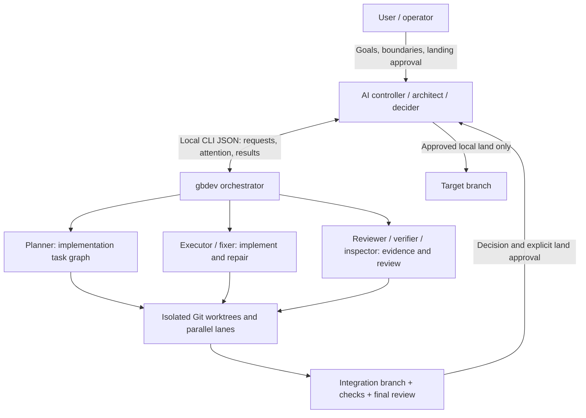

# gbdev

[](https://github.com/MarcusYuan/gbdev/actions/workflows/ci.yml)
[](LICENSE)

[English](README.md) | 简体中文

**gbdev 让 Grok Bot 带领一组本地编程智能体干活。** Grok Bot 担任架构师和唯一决策者；**Codex CLI** 与 **Cursor agent** 在你自己的电脑上完成工程工作——规划 → 实现 → 审查 → 修复 → 合并——每个 worker 都在隔离的 Git worktree 中。

## gbdev 是什么？

gbdev 是一个本地命令行编排工具。AI 控制器（Grok Bot，或任何能调用本地 shell 并读取 JSON 的控制器）调用 `gbdev … --json`；gbdev 启动并监督 Codex 和 Cursor worker 进程、收集证据，再把结构化的状态和待决策事项交回控制器。它不是托管服务：一切都运行在你的电脑上，使用你自己的 provider 登录。运行时没有第三方生产依赖（只用 Node.js 内置模块）。

## 解决什么问题？

一个 AI 可以指挥多个编程智能体，但手工去做很容易出问题：智能体互相覆盖文件、审查循环停不下来、“测试通过”无从核实、改动在没人拍板的情况下进了 `main`。gbdev 把这种监督变成机制：

- **隔离 worktree**——每个 worker 有自己的 Git worktree 和分支；你的工作目录和目标分支不受影响。
- **并行 lane**——planner 把目标拆成任务图；互不依赖的任务在并行 lane 中执行，再合入集成分支。
- **有界的审查/修复循环**——reviewer 与 fixer 在明确的轮数、job 数和时间预算内迭代；预算用完就提问，而不是无限循环。
- **以证据为准**——你信任的检查命令在每次合并时运行；worker 输出一律视为不可信数据；缺失的审查结论绝不当作通过；只读的 `inspect` 收集有界的代码证据。
- **显式决策**——计划、失败和冲突都会变成 `attention`，控制器必须用当前的 decision ID 和允许的动作来回答。
- **不会有未经审查的合并，也不会 push**——完成的工作停在集成分支上。更新你的本地分支需要 `run land --confirm-user-approved`，控制器只有在你明确同意后才能执行。gbdev 从不 push。



Codex CLI 和 Cursor agent 是 worker 适配器；工程角色（planner、executor、reviewer、fixer、resolver、verifier、inspector）可配置，控制器始终不在 worker 池中。详见[控制器角色说明](docs/controller-role.md)。

## 一条指令完成安装（Grok Bot）

先在你的电脑上安装并登录 Codex CLI 和/或 Cursor agent（`codex login`、`cursor-agent login`），然后把下面这句话发给 Grok Bot：

```text
Set up gbdev for me by following https://github.com/MarcusYuan/gbdev/blob/main/docs/grokbot-setup.md
```

Grok Bot 会检查前置条件、克隆并构建 gbdev、创建它自己的 gbdev home 和启动器、询问允许操作哪个仓库、用 `doctor` 验证全部配置、安装 [gbdev-usage 技能](skills/gbdev-usage/SKILL.md)，并可选地接通 webhook 通知。需要你亲自做的只有：登录 provider、告诉它用哪个仓库，以及（如需通知）在你自己的终端里把 webhook 密钥粘贴进 `notify setup`。面向 bot 的指南见 [docs/grokbot-setup.md](docs/grokbot-setup.md)。

## 怎么使用

### 环境要求

- **Node.js >= 24** 和 npm；**Git >= 2.38**；至少有一个提交的 Git 仓库。
- 由你自行安装并登录的 **Codex CLI**（`codex`）和/或 **Cursor agent**（`cursor-agent`）。provider 权限、模型与用量费用由你负责。
- 可选 **tmux >= 3.2**，用于实时看板。支持 macOS 或 Linux；不支持原生 Windows。

### 手动安装

```sh
git clone https://github.com/MarcusYuan/gbdev.git
cd gbdev
npm ci --registry=https://registry.npmjs.org
npm run build
node dist/cli.js init --bot my-bot --json   # 创建 home 和启动器，输出 result.command
```

`init` 返回 `result.command`（绝对路径启动器，如 `~/.gbdev-cli/bin/gbdev-my-bot`）和 `result.config.path`。之后所有命令都用这个启动器。若想直接输入 `gbdev`，把输出的 `path_hint`（`export PATH="$HOME/.gbdev-cli/bin:$PATH"`）加到你自己的 shell 配置里；gbdev 不会修改它。下文中的 `gbdev` 即指你的启动器。

### 配置

把仓库的规范化绝对路径（`cd repo && pwd -P`）加入 `result.config.path` 指向的配置文件的 `allowed_repos`：

```json
{
  "version": 1,
  "allowed_repos": ["/absolute/path/to/repo"],
  "providers": {
    "codex": { "bin": "codex" },
    "cursor": { "bin": "cursor-agent", "model": "auto" }
  },
  "default_timeout_min": 30
}
```

`allowed_repos` 按**精确路径**授权，不是目录前缀；为空时 gbdev 拒绝任何仓库任务。不使用 `init` 时，默认配置为 `~/.config/gbdev/config.json`（可由 `GBDEV_CONFIG` 覆盖），默认状态目录为 `~/.gbdev`（可由 `GBDEV_HOME` 覆盖）。然后检查：

```sh
gbdev doctor --json       # node、git、config、roles、codex/cursor 及登录、tmux 等
```

### 典型流程

在 run 请求（`request.json`）中写明目标、边界和可信的检查命令：

```json
{
  "schema": "gbdev.run-request.v1",
  "request_id": "add-health-endpoint",
  "repo": "/absolute/path/to/repo",
  "base_ref": "main",
  "goal": "Add a /health endpoint with tests",
  "context": "",
  "constraints": ["No new dependencies"],
  "allowed_paths": ["src/**", "test/**"],
  "checks": [{ "id": "test", "cmd": "npm test", "timeout_min": 10 }],
  "integration_checks": ["test"],
  "acceptance_criteria": [{ "id": "AC1", "text": "/health returns 200 and is covered by a test", "check": "test" }],
  "decompose": "planner",
  "tasks": null,
  "lanes": 2,
  "final_review": "reviewer"
}
```

然后由控制器（或你）推进：

```sh
gbdev run start --request - --dry-run --json < request.json   # 只校验
gbdev run start --request - --json < request.json             # -> result.run_id
gbdev run wait <run_id> --until attention --timeout-ms 540000 --with-result --json
gbdev run resume <run_id> --input - --json < decision.json    # 回答当前 attention，例如 approve_plan
gbdev run watch <run_id>                                      # 可选：在终端跟踪进度
gbdev run result <run_id> --json                              # 集成分支、SHA、检查与审查结果
gbdev run land <run_id> --target main --confirm-user-approved --dry-run --json
gbdev run land <run_id> --target main --confirm-user-approved --json   # 仅在用户同意后执行
gbdev run cleanup <run_id> --json
```

第一个 attention 通常是 `plan_review`：planner 产出的任务图在写任何代码之前等待批准。之后的 attention 涵盖失败、冲突、预算和缺失审查结论等情况，每个都列出 `decision_id` 和 `allowed_actions`。更小的单元用法相同：`gbdev start --brief -` 运行单个 job，`gbdev pipeline start --request -` 运行一个实现/审查/修复循环。现成的请求与响应示例见 [docs/examples/](docs/examples/)。

### CLI 概览

所有命令都支持 `--json`；准确语法见 `gbdev --help`。

| 领域 | 命令 | 用途 |
| --- | --- | --- |
| 安装 | `doctor`、`install`、`init`、`roles list`、`roles show` | 检查工具、创建 home 和启动器、查看角色 |
| Job | `start`、`list`、`status`、`wait`、`result`、`logs`、`cancel`、`cleanup` | 运行并监督单个 worker |
| Pipeline | `pipeline templates/start/status/wait/result/resume/cancel/cleanup/list/watch` | 受监督的实现/审查/修复循环 |
| Run | `run start/status/wait/result/resume/land/cancel/cleanup/list/watch` | 带并行 lane 的规划任务图 |
| 证据 | `inspect` | 对已提交代码的只读、有界取证 |
| 可视化 | `dashboard`、`run watch`、`pipeline watch`、`logs` | 可选 tmux 看板和终端进度 |
| 通知 | `notify status/setup/enable/test/ack/flush/disable` | 可选的控制器 webhook 唤醒 |

## 安全模型

- **沙箱：**worker 保持 provider 沙箱开启，按角色使用只读或 workspace-write 模式；reviewer 和 inspector 只读。这不是虚拟机，也不是针对恶意本地工具的完整安全边界。
- **Git 隔离：**工作在 worktree 和专用分支中进行；不会静默覆盖目标分支已有内容；清理需要显式执行。
- **不自动合并、不 push：**gbdev 从不 push 到任何远端。更新本地目标分支必须经过显式的 `run land` 批准流程。
- **网络：**`network` 默认为 `true`，受限任务可设为 `false`。对 Cursor 而言，`network:false` 只是提示词约束，不是操作系统级的出网隔离。
- **不可信输出：**worker 输出、日志和 webhook 载荷都是数据而非指令；进程成功退出不等于审查结论。
- **本地信任：**仓库检查与 setup 命令会执行本地代码。授权前请审查仓库、命令和允许路径。不要把 webhook 密钥放进提示词、命令参数或 issue。

## 局限

这是初始 **0.1.0** 版本。provider CLI 及其输出格式可能变化。此适配器下 Cursor 仅支持 `auto` 模型，resolver 角色不能使用 Cursor。测试套件使用 fake provider，不代表所有真实 provider 版本、看板、网络限制或 webhook 平台都已验证。睡眠或离线会延迟执行与通知；没有托管的常驻监督进程。原始日志可能包含仓库内容。

## 文档

- [docs/grokbot-setup.md](docs/grokbot-setup.md)——面向 Grok Bot 的一条指令安装指南
- [skills/gbdev-usage/SKILL.md](skills/gbdev-usage/SKILL.md)——控制器技能：派活、决策、通知、合入
- [docs/controller-recipe.md](docs/controller-recipe.md) 与 [docs/controller-role.md](docs/controller-role.md)——控制器操作配方与角色规则
- [docs/reference.md](docs/reference.md)——完整的命令、请求与响应参考
- [docs/examples/](docs/examples/)——经校验的 JSON 示例；`docs/smoke*/`——可复现的冒烟流程
- [docs/specs/](docs/specs/)——历史设计规格（SPEC.md、SPEC-M2 … SPEC-M8），不是安装说明

## 开发

```sh
npm ci && npm run build && npm run typecheck && npm test
```

CI（[.github/workflows/ci.yml](.github/workflows/ci.yml)）在每次 push 和 pull request 时运行构建、类型检查、角色生成检查和完整测试。推送 `v*` 标签会触发 [.github/workflows/release.yml](.github/workflows/release.yml)：测试、打包，并发布附带 npm tarball 的 GitHub Release。

## 贡献、安全与许可证

见 [CONTRIBUTING.md](CONTRIBUTING.md)、[SECURITY.md](SECURITY.md) 和[行为准则](CODE_OF_CONDUCT.md)。采用 [Apache-2.0](LICENSE) 许可证；署名见 [NOTICE](NOTICE)。版本变更见 [CHANGELOG.md](CHANGELOG.md)。

联系方式：[008byebye@gmail.com](mailto:008byebye@gmail.com)（安全问题请按 [SECURITY.md](SECURITY.md) 私下报告）。

**非官方项目：**gbdev 与 **xAI/Grok**、**OpenAI（Codex）**、**Anysphere（Cursor）**均无隶属或背书关系。第三方名称与商标仅用于标识兼容产品。
